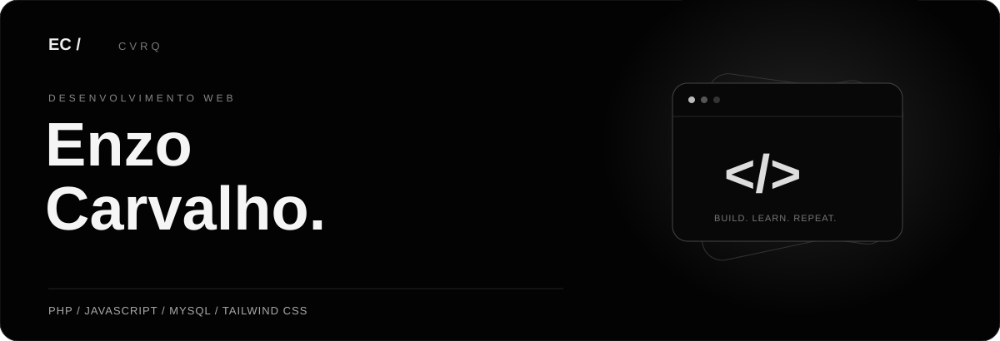
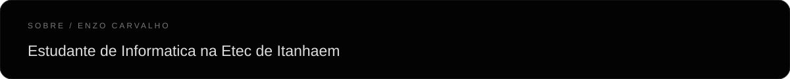
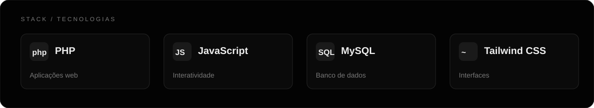

<a href="https://github.com/cvrq?tab=repositories"><strong>Explorar meus projetos ↗</strong></a>

  
  &nbsp;
  

### Contribuições

<picture>
  <source media="(prefers-color-scheme: dark)" srcset="https://raw.githubusercontent.com/cvrq/cvrq/output/github-snake-dark.svg" />
  <source media="(prefers-color-scheme: light)" srcset="https://raw.githubusercontent.com/cvrq/cvrq/output/github-snake.svg" />
  
</picture>
